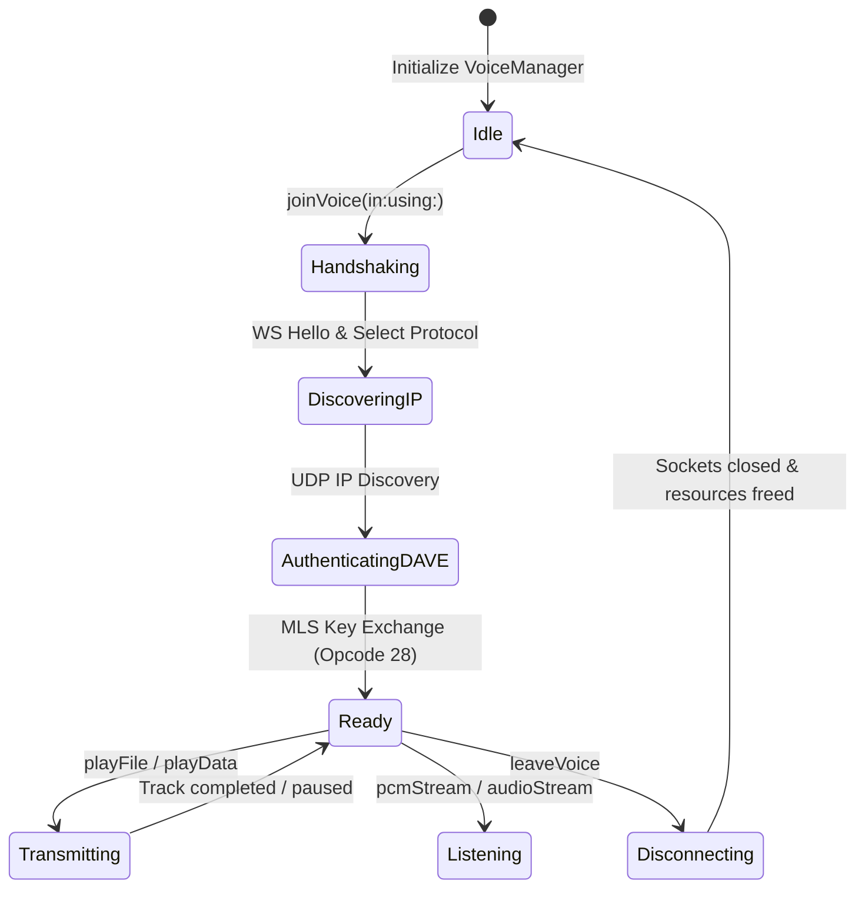

# Chapter 01: Getting Started & Voice Lifecycle

This chapter covers the foundational architecture of `DiscordBMVoice`, including dependency installation, gateway binding, voice lifecycle state transitions, and snowflake conversions.

---

## 1. Package Installation

Add `DiscordBMVoice` to your `Package.swift`:

```swift
// swift-tools-version: 6.2
import PackageDescription

let package = Package(
    name: "VoiceApp",
    platforms: [.macOS(.v13)],
    dependencies: [
        .package(url: "https://github.com/DiscordBM/DiscordBM.git", from: "1.9.0"),
        .package(url: "https://github.com/DiscordBM/DiscordBMVoice.git", branch: "main"),
    ],
    targets: [
        .executableTarget(
            name: "VoiceApp",
            dependencies: [
                .product(name: "DiscordBM", package: "DiscordBM"),
                .product(name: "DiscordVoice", package: "DiscordBMVoice"),
            ]
        ),
    ]
)
```

> [!Tip]
> Always import `DiscordVoice` when building with `DiscordBM`. It exports `DiscordBMVoice` along with native DiscordBM snowflake overloads and gateway helpers.

---

## 2. Gateway Event Binding

Discord voice connections require two pieces of data from the main Discord Gateway:
1. `VOICE_STATE_UPDATE`: Contains the user's `session_id`.
2. `VOICE_SERVER_UPDATE`: Contains the guild's voice `token` and voice `endpoint`.

`DiscordVoice` provides `bot.bind(to: voiceManager)` to wire these events automatically:

```swift
import DiscordBM
import DiscordGateway
import DiscordVoice

let bot = await BotGatewayManager(
    token: <#Your Bot Token#>,
    intents: [.guilds, .guildVoiceStates, .guildMessages]
)

let botUserID = try await bot.client.getOwnUser().decode().id

let voiceManager = VoiceManager(
    gateway: bot,
    userID: botUserID
)

// One-line binding starts a structured Task forwarding events to voiceManager:
bot.bind(to: voiceManager)

await bot.connect()
```

---

## 3. Voice Connection Lifecycle

A voice connection progresses through five distinct phases:



### Joining a Channel

```swift
// Direct join via ChannelSnowflake:
let connection = try await channelID.joinVoice(
    in: guildID,
    using: voiceManager
)

// Or resolve the interaction author's channel:
if let userChannel = await interaction.memberVoiceChannel(using: voiceManager) {
    let connection = try await userChannel.joinVoice(in: guildID, using: voiceManager)
}
```

### Disconnecting from a Channel

```swift
// Leaves the channel and cancels background network tasks:
await voiceManager.leave(guildID: guildID)
```

---

## 4. Snowflake Conversions

`DiscordBMVoice` defines an internal lightweight `Snowflake` type (`UInt64`). When using `DiscordVoice`, conversions between DiscordBM's `ChannelSnowflake`, `GuildSnowflake`, and `UserSnowflake` are automatic:

```swift
let bmGuildID: GuildSnowflake = "123456789012345678"

// Bidirectional conversions:
let voiceSnowflake = DiscordBMVoice.Snowflake(bmGuildID)
let backToBM: GuildSnowflake = voiceSnowflake.asGuildSnowflake
```

---

## 5. Standalone Gateway (Without DiscordBM)

If you use a custom Discord gateway implementation, pass a closure to `VoiceManager`:

```swift
import DiscordBMVoice

let voiceManager = VoiceManager(
    userID: <#Bot User ID#>
) { update in
    await myCustomGateway.sendVoiceStateUpdate(
        guildID: update.guildID,
        channelID: update.channelID,
        selfMute: update.selfMute,
        selfDeaf: update.selfDeaf
    )
}

// Forward raw events:
await voiceManager.handleVoiceServerUpdate(guildID: guildID, endpoint: endpoint, token: token)
await voiceManager.handleVoiceStateUpdate(guildID: guildID, channelID: channelID, userID: userID, sessionID: sessionID)
```

---

## 6. VoiceConfiguration Options

Fine-tune timeouts, reconnect policies, logging, and audio scheduling:

```swift
var config = VoiceConfiguration(
    joinTimeout: .seconds(30),       // Max wait for handshake and DAVE MLS
    maxReconnectAttempts: 5,         // Max automated gateway reconnection retries
    makeLogger: { label in
        var logger = Logger(label: "Voice.\(label)")
        logger.logLevel = .info
        return logger
    }
)

// For large bots (thousands of servers), enable high-scale guild sharding:
let highScaleConfig = VoiceConfiguration.highScale(guildsPerWorker: 16)
```

---

## 7. DiscordVoice Extension Index

Importing `DiscordVoice` provides direct overloads and extensions on DiscordBM types:

| Extended Type | Method / Property | Description |
| :--- | :--- | :--- |
| `GatewayManager` | `bind(to: VoiceManager)` | Starts background task routing voice gateway events |
| `ChannelSnowflake` | `joinVoice(in:using:)` | Joins channel directly using `ChannelSnowflake` |
| `GuildSnowflake` | `leaveVoice(using:)` | Leaves active channel in guild |
| `GuildSnowflake` | `voiceConnection(using:)` | Returns active `VoiceConnection` for guild |
| `Interaction` | `memberVoiceChannel(using:)` | Resolves the interaction author's current voice channel |
| `VoiceManager` | `voiceChannel(for:in:)` | Looks up channel a user is currently in |
| `VoiceManager` | `usersInVoice(in:)` | Real-time `[UserSnowflake: ChannelSnowflake]` snapshot |
| `VoiceConnection` | `audioStream(for: UserSnowflake)` | Inbound decrypted Opus stream for user |
| `VoiceConnection` | `pcmStream(for: UserSnowflake)` | Inbound 20ms Float PCM stream for user |
| `TrackMetadata` | `init(..., requester: UserSnowflake?)` | Requester tracking via DiscordBM user snowflake |


