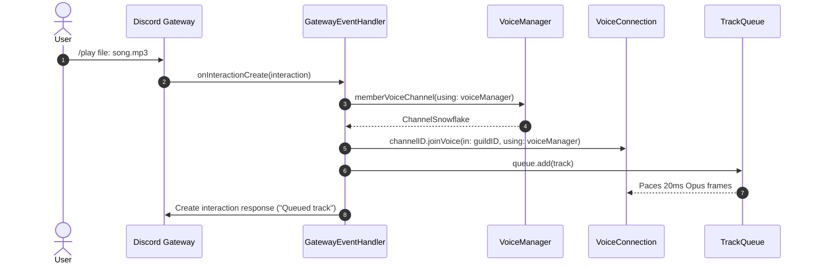

# Chapter 02: Slash-Command Music Bot

This chapter details how to build a full-featured Discord music bot with `DiscordBMVoice` and `DiscordVoice`, supporting sequential queuing, playback control, seeking, metadata tracking, and interaction helpers.

---

## Architectural Workflow



---

## 1. The Track Queue (`TrackQueue`)

Each `VoiceConnection` contains an actor-isolated `TrackQueue` (`connection.queue`):
* Adding tracks to an empty queue starts playback immediately.
* Adding tracks while audio is playing appends them sequentially.
* `skip()` immediately stops the active track and advances to the next track.
* `shuffle()` randomizes upcoming items in the queue without interrupting the current track.

```swift
let queue = await connection.queue

// Add an audio file:
try await queue.addFile("music/track1.mp3", title: "Track One")

// Add a pre-configured AudioTrack with metadata:
let track = try AudioTrack.file("music/track2.flac", metadata: metadata)
await queue.add(track)

// Skip the current track:
let skippedTrack = await queue.skip()
```

---

## 2. Audio Seeking (`seek(to:)`)

Tracks support sub-second positioning using Swift's standard `Duration` or `Double` seconds:

```swift
// Jump forward to 2 minutes 15 seconds:
try await queue.seek(to: .seconds(135))

// Inspect current track playback position:
if let current = await queue.currentTrack {
    let elapsedDuration: Duration = await current.position
    let elapsedSeconds: Double = await current.positionSeconds
    print("Elapsed: \(elapsedSeconds) seconds")
}
```

---

## 3. Track Metadata & User Context

You can attach strongly-typed metadata and custom user context to any track:

```swift
let metadata = TrackMetadata(
    title: "Bohemian Rhapsody",
    artist: "Queen",
    duration: .seconds(354),
    thumbnailURL: "https://example.com/cover.jpg",
    sourceURL: "https://example.com/audio.mp3",
    requester: interaction.user?.id
)

struct BotContext: Sendable {
    let commandChannelID: ChannelSnowflake
}

var userData = TrackUserData(BotContext(commandChannelID: interaction.channel_id!))

let track = try AudioTrack.file("song.mp3", metadata: metadata, userData: userData)
await queue.add(track)

// Accessing metadata nonisolated (without await):
print("Title: \(track.metadata.title ?? "Unknown")")

// Retrieving strongly-typed user context:
if let ctx = await track.userData[BotContext.self] {
    print("Requested in channel: \(ctx.commandChannelID)")
}
```

---

## 4. Queue Lifecycle Event Stream

Subscribe to the async event stream to update now-playing banners or log track transitions:

```swift
Task {
    for await event in await queue.events {
        switch event {
        case .trackStarted(let track):
            print("Started: \(track.title ?? "Unknown")")
        case .trackEnded(let track):
            print("Finished: \(track.title ?? "Unknown")")
        case .trackSkipped(let track):
            print("Skipped: \(track.title ?? "Unknown")")
        case .queueEmptied:
            print("Queue empty, idle in channel.")
        }
    }
}
```

---

## 5. Complete Runnable Implementation

See [main.swift](main.swift) for the complete, compile-verified application code.
