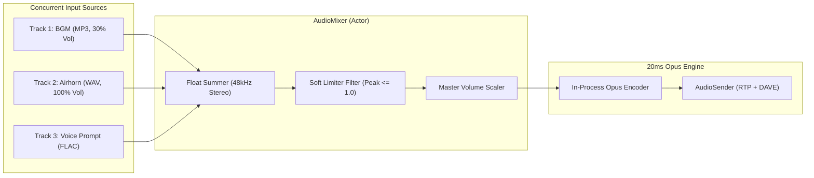

# Chapter 03: Multi-Track Mixer & Soundboard

This chapter covers concurrent multi-track audio mixing and zero-latency soundboard caching using `AudioMixer` and `SoundboardCache`.

---

## Architecture Overview



---

## 1. Concurrent Multi-Track Mixing

In Discord, only one UDP audio stream exists per bot connection. To play multiple audio sources at the same time (e.g. background music, sound effects, and text-to-speech), `DiscordBMVoice` incorporates a built-in software `AudioMixer`.

```swift
// 1. Start background music at lower volume:
let bgm = try await connection.playFile("bgm.mp3", title: "Background Music")
await bgm.setVolume(0.35)

// 2. Play a sound effect concurrently:
let sfx = try await connection.playFile("horn.wav", title: "Airhorn")
await sfx.setVolume(1.0)

// 3. Adjust master volume output across all mixed tracks:
await connection.mixer.setMasterVolume(0.80)

// 4. Stop all tracks in the mixer at once:
await connection.stopAll()
```

---

## 2. Zero-Latency Soundboard Caching (`SoundboardCache`)

Repeatedly reading audio clips from disk and decoding them in real-time introduces I/O latency and CPU overhead.

`SoundboardCache` preloads clips into RAM during bot initialization:

```swift
// Preload as pre-encoded Opus frames:
// Ideal for soundboard clips with 0ms decode overhead
try await SoundboardCache.shared.preload(
    key: "airhorn",
    file: "sounds/airhorn.mp3",
    kind: .opus
)

// Preload as raw 32-bit Float PCM:
// Ideal when real-time filters or pitch shifting will be applied
try await SoundboardCache.shared.preload(
    key: "intro_music",
    file: "sounds/intro.wav",
    kind: .pcm
)
```

### Triggering Cached Clips

```swift
// Play immediately over the active voice connection:
await connection.playSoundboard(key: "airhorn", volume: 1.0)

// Or enqueue into the sequential TrackQueue:
await connection.queue.addSoundboard(key: "airhorn")
```

---

## 3. Dynamic Auto-Ducking

When playing background music, you often want music volume to lower automatically whenever a human speaks in the channel.

```swift
// Automatically lowers music volume to 20% while any member speaks:
await connection.enableAutoDucking(duckVolume: 0.20, onSpeaking: true)
```

---

## 4. Complete Runnable Implementation

See [main.swift](main.swift) for the complete implementation.
