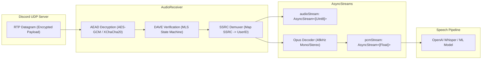

# Chapter 05: Inbound Audio & AI Speech Transcription

This chapter covers receiving decrypted audio from participants, decoding Opus packets into 32-bit Float PCM, and streaming samples to AI speech models such as OpenAI Whisper.

---

## Inbound Audio Architecture



---

## 1. Subscribing to Decoded Float PCM Streams

You can subscribe to audio per-user or channel-wide. Every yielded element contains 20ms of audio (960 samples per channel):

### A. Specific User PCM Stream
```swift
let userStream = await connection.pcmStream(for: userSnowflake)
Task {
    for await pcmFrame in userStream {
        // [Float] samples normalized between -1.0 and 1.0
        whisperModel.feedAudio(pcmFrame)
    }
}
```

### B. Channel-Wide PCM Stream
```swift
let allUsersStream = await connection.pcmStream()
Task {
    for await (userID, pcmFrame) in allUsersStream {
        speechService.processUserChunk(userID: userID, samples: pcmFrame)
    }
}
```

---

## 2. Raw Decrypted Opus Streams

If you are saving audio directly to an `.ogg` file or forwarding audio to an external media router without decoding to PCM, subscribe to `audioStream`:

```swift
let opusStream = await connection.audioStream(for: userSnowflake)
Task {
    for await opusPacket in opusStream {
        // [UInt8] raw Opus packet
        oggWriter.writePacket(opusPacket)
    }
}
```

---

## 3. Speaking State Updates

Discord emits speaking updates to inform clients who is speaking:

```swift
for await update in await connection.speakingUpdates {
    print("User \(update.userID) speaking: \(update.isSpeaking)")
}
```

---

## 4. Custom Opus Decoders

If you are using a custom or accelerated C-based Opus decoder, plug it in directly:

```swift
await connection.setCustomDecoder(AnyOpusDecoder { opusPacket in
    myAcceleratedDecoder.decode(opusPacket)
})
```

---

## 5. Complete Runnable Implementation

See [main.swift](main.swift) for the complete implementation.
