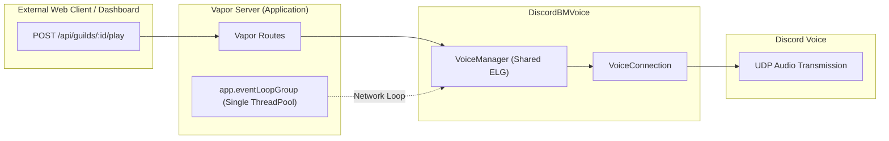

# Chapter 06: Vapor & Web Services Integration

This chapter covers embedding `DiscordBMVoice` inside a [Vapor](https://vapor.codes) server, sharing Vapor's `EventLoopGroup` for UDP networking, and building REST endpoints or webhooks to trigger audio in voice channels.

---

## Architecture Overview



---

## 1. Sharing Vapor's EventLoopGroup

By passing `app.eventLoopGroup` to `VoiceManager`, you avoid spawning extra event loop threads and reduce system resource contention:

```swift
import DiscordBMVoice
import Vapor

func configureVoice(app: Application, botUserID: Snowflake) -> VoiceManager {
    VoiceManager(
        eventLoopGroup: app.eventLoopGroup,
        userID: botUserID
    ) { update in
        // Send gateway voice state update via your gateway client
    }
}
```

---

## 2. Exposing REST Endpoints

Allow web dashboards, webhook triggers, or internal microservices to control voice playback:

```swift
app.post("api", "guilds", ":guildID", "play") { req async throws -> Response in
    guard let guildIDStr = req.parameters.get("guildID"),
          let guildID = Snowflake(guildIDStr) else {
        throw Abort(.badRequest, reason: "Invalid guildID")
    }

    struct PlayRequest: Content {
        let channelID: String
        let file: String
    }

    let payload = try req.content.decode(PlayRequest.self)
    guard let channelID = Snowflake(payload.channelID) else {
        throw Abort(.badRequest, reason: "Invalid channelID")
    }

    let connection = try await voiceManager.join(guildID: guildID, channelID: channelID)
    _ = try await connection.playFile(payload.file, title: payload.file)

    return Response(status: .ok)
}
```

---

## 3. Complete Runnable Implementation

See [main.swift](main.swift) for the complete Vapor application implementation.
