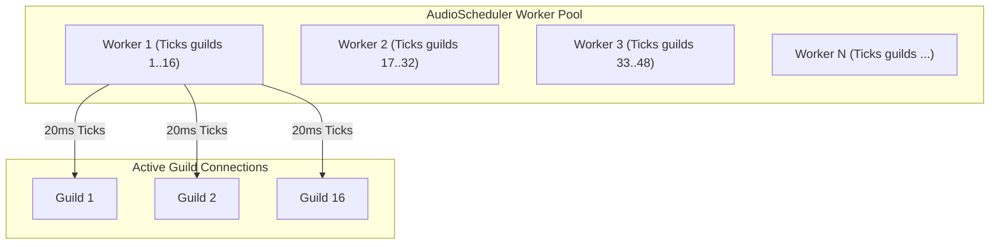

# Chapter 07: High-Scale Multi-Guild Audio Scheduler

This chapter covers operating `DiscordBMVoice` in bots serving thousands of concurrent voice channels using the `AudioScheduler` worker pool architecture.

---

## 1. The Multi-Guild Bottleneck

In smaller bots, running an independent 20ms timer loop per guild works well. However, when scaling to thousands of concurrent voice sessions:
* Operating 5,000 independent `Task.sleep(for: .milliseconds(20))` loops triggers timer drift, thread context-switching, and high CPU usage.
* Discord strictly requires 20ms packet pacing (+-1ms). Packet jitter results in robotic or dropped audio.

---

## 2. The Worker Pool Solution

Inspired by Songbird, `AudioScheduler` organizes guilds into partitioned worker threads:



Each worker runs a single high-precision `ContinuousClock` loop that paces up to `guildsPerWorker` connections simultaneously.

---

## 3. Configuring High-Scale Mode

Enable high-scale scheduling during `VoiceManager` initialization:

```swift
// Shard up to 16 guilds per worker loop:
let config = VoiceConfiguration.highScale(guildsPerWorker: 16)

let voiceManager = VoiceManager(
    gateway: bot,
    userID: botUserID,
    config: config
)
```

### Memory Profiling & Zero-Allocation Loops

`AudioMixer` preallocates scratch PCM mixing buffers so that 20ms transmission ticks require zero heap memory allocations. When a guild disconnects, the worker automatically reclaims the guild's slot and shuts down idle loops.

---

## 4. Complete Runnable Implementation

See [main.swift](main.swift) for the complete implementation.
