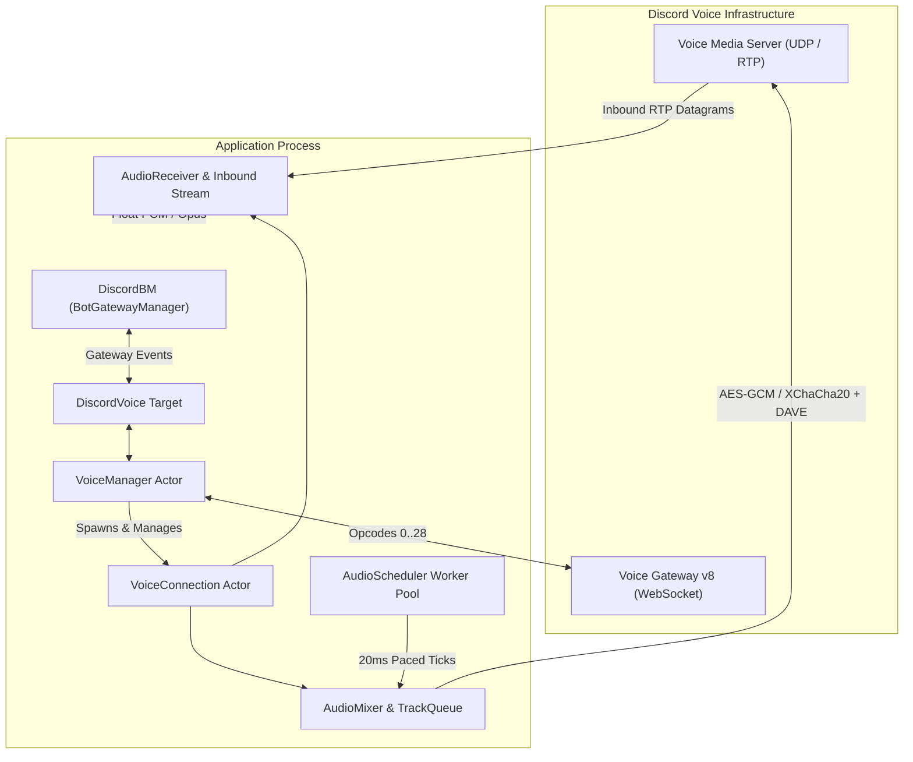

# Playbook

Implementation reference and architecture documentation for `DiscordBMVoice`.

---

## Chapters

| Chapter | Focus | Reference Code |
| :--- | :--- | :--- |
| [01. Getting Started](01-GettingStarted/README.md) | Gateway binding, voice connection lifecycle, configuration | `VoiceManager` |
| [02. Music Playback](02-BasicMusicBot/README.md) | TrackQueue, playlist management, seeking, metadata | [main.swift](02-BasicMusicBot/main.swift) |
| [03. Multi-Track Mixer & Soundboard](03-MultiTrackMixerAndSoundboard/README.md) | Concurrent audio tracks, SoundboardCache, volume ducking | [main.swift](03-MultiTrackMixerAndSoundboard/main.swift) |
| [04. DSP & Audio Filters](04-AudioFiltersAndDucking/README.md) | Float PCM pipelines, soft limiter, Voice Activity Detection | [main.swift](04-AudioFiltersAndDucking/main.swift) |
| [05. Audio Ingestion & Transcription](05-InboundAudioAndTranscription/README.md) | Inbound Opus & Float PCM streams, Whisper integration | [main.swift](05-InboundAudioAndTranscription/main.swift) |
| [06. Web Services & Vapor](06-VaporAndWebServices/README.md) | EventLoopGroup sharing, REST endpoints, lifecycle | [main.swift](06-VaporAndWebServices/main.swift) |
| [07. High-Scale Scheduling](07-HighScaleAudioScheduler/README.md) | Multi-guild worker pool, continuous 20ms pacing | [main.swift](07-HighScaleAudioScheduler/main.swift) |
| [08. Protocol Internals](08-DAVEProtocolDeepDive/README.md) | DAVE MLS state machines, AEAD transport, RTP framing | Specification |

---

## Architecture

---

## Environment Requirements

* **Swift**: 6.2 or later
* **Platforms**: macOS 13+, Linux (Ubuntu 22.04+, Debian 12+, Amazon Linux 2023)
* **Core Dependencies**: `SwiftNIO`, `DiscordBM`, `DiscordAudioKit`
